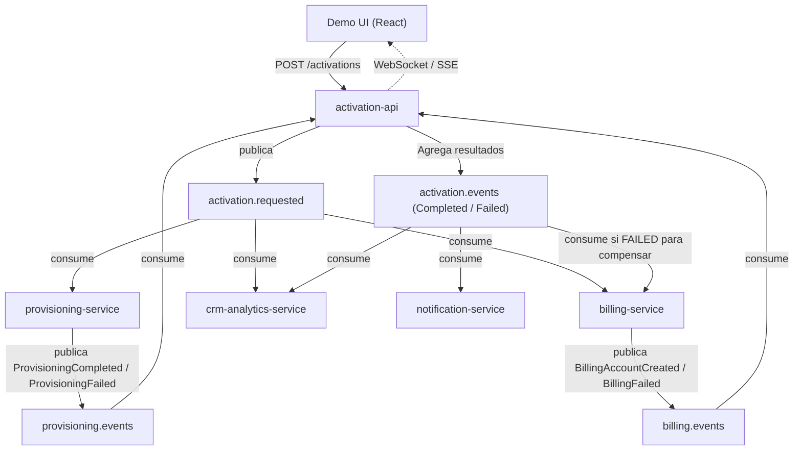

# Arquitectura y Especificación del Sistema

Este documento describe la arquitectura para la **POC Activación de Servicios con Kafka** de la materia Sistemas Distribuidos (UTN FRCU - 2026).

## Resumen del Flujo de Activación

## Topics de Kafka (3 Particiones c/u, Clave = customerId)
1. `activation.requested` y `activation.requested.dlq`
2. `billing.events` y `billing.events.dlq`
3. `provisioning.events` y `provisioning.events.dlq`
4. `activation.events` y `activation.events.dlq`
